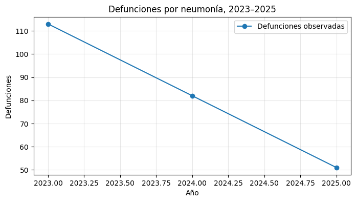

# Challenge: IRA y neumonía en menores de 5 años en el Perú

**Caso del flyer:** episodios de IRA y defunciones por neumonía,
2023--2025.

Datos transcritos del flyer: - Episodios de IRA: 2023 = 1,003,178; 2024
= 883,959; 2025 = 824,978. - Defunciones por neumonía: 2023 = 113; 2024
= 82; 2025 = 51. - Intervenciones mencionadas: vacunación, lavado de
manos, ventilación, campañas preventivas y atención oportuna.

**Advertencia:** solo hay tres observaciones anuales. Las predicciones
son demostrativas y no son pronósticos oficiales ni pruebas de
causalidad.

# Bloque 1 --- Pipeline de razonamiento, búsqueda y resultados

Representamos el problema como un espacio de estados y usamos BFS para
encontrar una ruta de acciones. Las puntuaciones de alternativas son
hipotéticas, solo para demostrar el método.

``` python
from collections import deque
import pandas as pd
import matplotlib.pyplot as plt

# Variables observadas del caso
anios = [2023, 2024, 2025]
episodios_ira = [1003178, 883959, 824978]
defunciones_neumonia = [113, 82, 51]
vacunas_neumococo_reportadas = 2226142
vacunas_influenza_reportadas_millones = 8.2

# Definición del problema
problema = "Reducir episodios de IRA y defunciones por neumonía en menores de 5 años."
estado_inicial = "Situación epidemiológica observada"
estado_objetivo = "Menor incidencia y mortalidad con seguimiento sanitario"

# Espacio de estados
espacio_estados = {
    "Situación epidemiológica observada": ["Evaluación de riesgos"],
    "Evaluación de riesgos": ["Planificación preventiva", "Atención oportuna"],
    "Planificación preventiva": ["Vacunación y campañas", "Higiene y ventilación"],
    "Vacunación y campañas": ["Seguimiento epidemiológico"],
    "Higiene y ventilación": ["Seguimiento epidemiológico"],
    "Atención oportuna": ["Seguimiento epidemiológico"],
    "Seguimiento epidemiológico": ["Evaluación de resultados"],
    "Evaluación de resultados": [estado_objetivo],
    estado_objetivo: []
}

def bfs_ruta(grafo, inicio, objetivo):
    cola = deque([(inicio, [inicio])])
    visitados = set()
    while cola:
        estado, ruta = cola.popleft()
        if estado == objetivo:
            return ruta
        if estado in visitados:
            continue
        visitados.add(estado)
        for siguiente in grafo.get(estado, []):
            if siguiente not in visitados:
                cola.append((siguiente, ruta + [siguiente]))
    return None

ruta = bfs_ruta(espacio_estados, estado_inicial, estado_objetivo)
print("PROBLEMA:", problema)
print("Estado inicial:", estado_inicial)
print("Estado objetivo:", estado_objetivo)
print("Ruta BFS:", " -> ".join(ruta) if ruta else "No se encontró ruta")

# Comparación didáctica de alternativas (puntuaciones hipotéticas de 1 a 5)
alternativas = pd.DataFrame({
    "Alternativa": ["Vacunación y campañas", "Higiene y ventilación", "Atención oportuna"],
    "Prevención": [5, 4, 2],
    "Factibilidad": [4, 5, 3],
    "Rapidez de respuesta": [3, 4, 5]
})
pesos = {"Prevención": 0.50, "Factibilidad": 0.25, "Rapidez de respuesta": 0.25}
alternativas["Puntuación ilustrativa"] = sum(alternativas[c] * p for c, p in pesos.items())
alternativas = alternativas.sort_values("Puntuación ilustrativa", ascending=False)
print("\nComparación ilustrativa (no son datos oficiales):")
display(alternativas)

datos = pd.DataFrame({
    "Año": anios,
    "Episodios de IRA": episodios_ira,
    "Defunciones por neumonía": defunciones_neumonia
})
display(datos)

plt.figure(figsize=(8, 4))
plt.plot(anios, episodios_ira, marker="o", label="Episodios de IRA")
plt.xlabel("Año"); plt.ylabel("Número de episodios")
plt.title("Episodios de IRA, 2023–2025"); plt.grid(True, alpha=0.3); plt.legend()
plt.show()

plt.figure(figsize=(8, 4))
plt.plot(anios, defunciones_neumonia, marker="o", label="Defunciones por neumonía")
plt.xlabel("Año"); plt.ylabel("Número de defunciones")
plt.title("Defunciones por neumonía, 2023–2025"); plt.grid(True, alpha=0.3); plt.legend()
plt.show()
```

### Gráficas del Bloque 1


### Sustentación del Bloque 1

-   **Problema:** disminuir episodios de IRA y defunciones por neumonía
    en menores de cinco años.
-   **Espacio de estados:** representa las etapas desde la situación
    observada hasta la evaluación de resultados.
-   **BFS:** recorre los estados por niveles y encuentra una ruta al
    objetivo si existe.
-   **Comparación:** las puntuaciones y los pesos son supuestos
    didácticos; en un caso real deben definirse con evidencia y
    especialistas.
-   **Interpretación:** los datos muestran una tendencia descendente
    entre 2023 y 2025, pero no prueban qué intervención causó esa
    reducción.

# Bloque 2 --- Pipeline de predicción y gráfica

Se ajusta una regresión lineal para estimar numéricamente los episodios
de IRA. El espacio de estados y las variables del caso se repiten para
que este bloque funcione por separado.

``` python
import numpy as np
import pandas as pd
import matplotlib.pyplot as plt
from sklearn.linear_model import LinearRegression
from sklearn.metrics import mean_absolute_error

# Variables observadas del caso (bloque independiente)
anios = np.array([2023, 2024, 2025]).reshape(-1, 1)
episodios_ira = np.array([1003178, 883959, 824978])
defunciones_neumonia = np.array([113, 82, 51])
vacunas_neumococo_reportadas = 2226142
vacunas_influenza_reportadas_millones = 8.2

# Espacio de estados repetido en el bloque 2
estado_inicial = "Situación epidemiológica observada"
estado_objetivo = "Menor incidencia y mortalidad con seguimiento sanitario"
espacio_estados = {
    "Situación epidemiológica observada": ["Evaluación de riesgos"],
    "Evaluación de riesgos": ["Planificación preventiva", "Atención oportuna"],
    "Planificación preventiva": ["Vacunación y campañas", "Higiene y ventilación"],
    "Vacunación y campañas": ["Seguimiento epidemiológico"],
    "Higiene y ventilación": ["Seguimiento epidemiológico"],
    "Atención oportuna": ["Seguimiento epidemiológico"],
    "Seguimiento epidemiológico": ["Evaluación de resultados"],
    "Evaluación de resultados": [estado_objetivo],
    estado_objetivo: []
}
print("Estado inicial:", estado_inicial)
print("Estado objetivo:", estado_objetivo)
print("Estados del espacio:", list(espacio_estados.keys()))

# Modelo: año -> cantidad de episodios de IRA
modelo = LinearRegression()
modelo.fit(anios, episodios_ira)
predicciones_historicas = modelo.predict(anios)
mae = mean_absolute_error(episodios_ira, predicciones_historicas)
prediccion_2026 = max(0, int(round(modelo.predict(np.array([[2026]]))[0])))

print("\nModelo: regresión lineal")
print("Variable de entrada: año")
print("Variable objetivo: número de episodios de IRA")
print("Pendiente estimada:", round(modelo.coef_[0], 2))
print("MAE dentro de los datos de entrenamiento:", round(mae, 2))
print("Estimación ilustrativa para 2026:", prediccion_2026, "episodios")

# Gráfica observaciones + tendencia + estimación
anios_grafica = np.arange(2023, 2027).reshape(-1, 1)
ajuste = modelo.predict(anios_grafica)
plt.figure(figsize=(8, 4))
plt.scatter(anios.flatten(), episodios_ira, label="Datos observados")
plt.plot(anios_grafica.flatten(), ajuste, label="Tendencia lineal")
plt.scatter([2026], [prediccion_2026], marker="x", s=100, label="Estimación 2026")
plt.xlabel("Año"); plt.ylabel("Episodios de IRA")
plt.title("Regresión lineal de episodios de IRA")
plt.grid(True, alpha=0.3); plt.legend()
plt.show()

resumen = pd.DataFrame({
    "Año": [2023, 2024, 2025, 2026],
    "Episodios de IRA": [1003178, 883959, 824978, prediccion_2026],
    "Tipo": ["Observado", "Observado", "Observado", "Estimación ilustrativa"]
})
display(resumen)

plt.figure(figsize=(8, 4))
plt.plot([2023, 2024, 2025], defunciones_neumonia, marker="o",
         label="Defunciones observadas")
plt.xlabel("Año"); plt.ylabel("Defunciones")
plt.title("Defunciones por neumonía, 2023–2025")
plt.grid(True, alpha=0.3); plt.legend()
plt.show()
```

### Gráficas del Bloque 2


> **Nota:** la estimación de 2026 es únicamente demostrativa. Se basa en
> tres observaciones anuales y no debe interpretarse como un pronóstico
> oficial.

### Regresión y predicción



> **Interpretación:** La gráfica permite visualizar los resultados del modelo de predicción. La estimación debe interpretarse con precaución, ya que depende de los datos utilizados para entrenar el modelo.

### Sustentación del Bloque 2

-   **Modelo elegido:** regresión lineal porque predice una cantidad
    numérica.
-   **Entrada:** año. **Objetivo:** número de episodios de IRA.
    **Salida:** cantidad estimada, no probabilidad ni clase.
-   **Gráfica:** los puntos representan los valores observados y la
    línea representa la tendencia ajustada.
-   **Limitación:** hay solo tres observaciones anuales y faltan
    variables como cobertura real de vacunación, factores climáticos,
    datos regionales y condiciones socioeconómicas. La estimación de
    2026 es una demostración técnica, no un pronóstico confiable.
-   **Por qué no logística:** la regresión logística se usa para estimar
    la probabilidad de una clase, por ejemplo riesgo alto/bajo, y
    requiere datos etiquetados para esas clases.

## Conclusión

El flyer presenta una disminución de episodios de IRA y de defunciones
por neumonía entre 2023 y 2025. El Bloque 1 organiza la respuesta
sanitaria como un espacio de estados y compara alternativas de forma
didáctica. El Bloque 2 muestra una regresión lineal sobre la cantidad
anual de episodios. Para tomar decisiones reales se necesitan más datos
y variables explicativas; la tendencia por sí sola no demuestra
causalidad.
